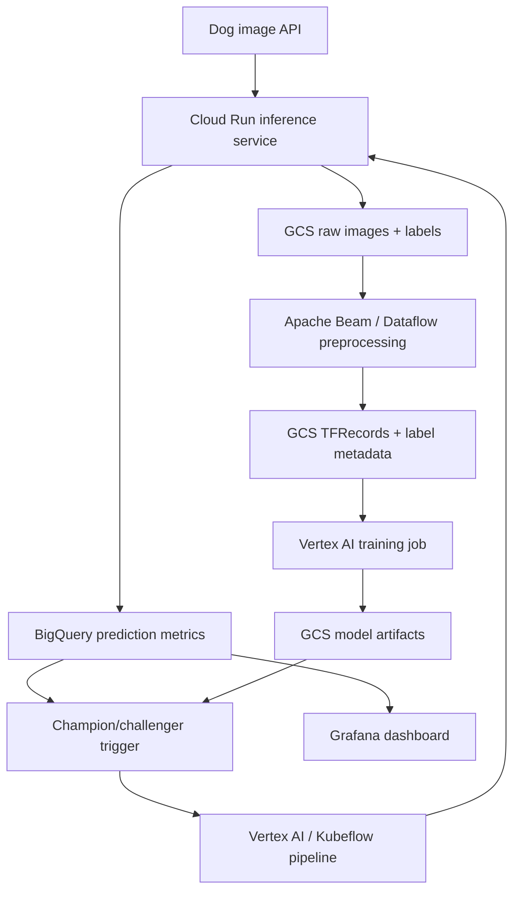
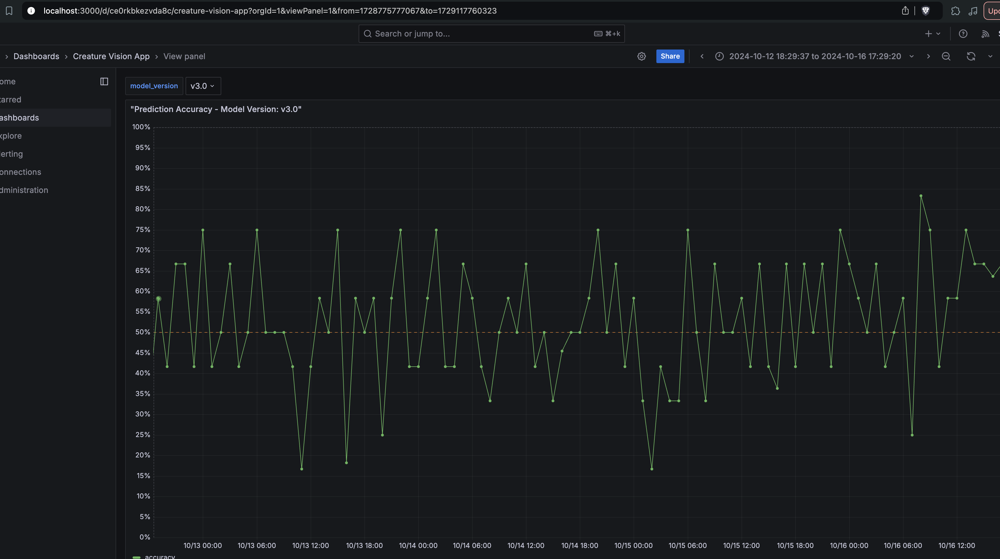

# Creature Vision

Continuous retraining pipeline for dog breed classification with TensorFlow,
Apache Beam/Dataflow, Vertex AI, Cloud Run, BigQuery, and Grafana.

The project collects live dog images, runs inference, stores prediction results,
builds TFRecords from accumulated examples, trains a new MobileNetV3-Small model,
and redeploys the selected model version through a Kubeflow/Vertex AI pipeline.

## Architecture



## What This Shows

- Production-shaped ML workflow: collection, preprocessing, training, deployment,
  metrics, and model promotion.
- Service boundaries for inference, preprocessing, training, and orchestration.
- GCP infrastructure and deployment assets for Cloud Run, Dataflow, Vertex AI,
  BigQuery, Grafana, and Terraform.
- Tests around the brittle parts of the code: model-version parsing, label matching,
  and Beam output formatting.

## Repository Layout

| Path | Purpose |
| --- | --- |
| `src/inference` | Flask inference service that fetches images, predicts labels, stores examples, and logs metrics. |
| `src/preprocessing` | Apache Beam pipeline that converts stored examples into TFRecords and class distribution metrics. |
| `src/training` | TensorFlow MobileNetV3 training package for Vertex AI custom jobs. |
| `src/trigger` | Cloud Function entry point for champion/challenger orchestration. |
| `src/kubeflow` | Vertex AI / Kubeflow pipeline compiler and deployment components. |
| `docker` | Service Dockerfiles and local compose files. |
| `infra` | Terraform resources for supporting GCP infrastructure. |
| `tests` | Focused unit tests for maintained Python modules. |

## Local Development

This repo uses `uv` for Python dependency management.

```sh
uv sync
make test
make lint
```

Useful commands:

```sh
make run-local SERVICE=inference VERSION=v3_0
make run-local SERVICE=preprocessing VERSION=v3_5
make run-training MODEL_VERSION=v3_5 PREVIOUS_VERSION=v3_4
make run-monitoring
```

The ML/runtime dependency set is intentionally heavy because it includes
TensorFlow, Apache Beam, Vertex AI, and Kubeflow tooling.

## Configuration

Most runtime settings can be overridden with environment variables:

| Variable | Default |
| --- | --- |
| `GOOGLE_CLOUD_PROJECT` | `creature-vision` |
| `CLOUD_LOCATION` | `us-east1` for preprocessing, `us-central1` for training |
| `MODEL_VERSION` | Required by inference |
| `MODEL_BUCKET` | `tf_models_cv` |
| `DATA_BUCKET_NAME` / `TRAINING_BUCKET` | `creature-vision-training-set` |
| `DATAFLOW_BUCKET_NAME` | `dataflow-use1` |
| `BQ_METRICS_DATASET` | `dog_prediction_app` |
| `BQ_METRICS_TABLE` | `prediction_metrics` |

Local commands that touch GCP require authenticated Application Default
Credentials:

```sh
gcloud auth application-default login
```

## Deployment Flow

1. Build and push service images with `make build-push SERVICE=<service> VERSION=<tag>`.
2. Build the Dataflow Flex Template with `make create-df-template VERSION=<tag>`.
3. Compile and upload the Vertex AI pipeline with `make compile-pipeline`.
4. Deploy the trigger Cloud Function with `make deploy-pipeline-cf`.
5. Invoke the trigger with `make test-pipeline-cf USE_CACHE=false`.

## Monitoring

Prediction metrics and class distribution metrics are written to BigQuery.
Grafana provisioning lives under `docker/inference/monitoring`.

```sh
make run-monitoring
```



## Demo Videos

- [Overview](https://www.youtube.com/watch?v=NxDV6e29O94)
- [Champion/challenger](https://youtu.be/2J20L-5yWIk)
- [Kubeflow and ML lifecycle](https://youtu.be/_AHTLu679sg)
- [Data distribution monitoring, KL divergence](https://www.youtube.com/watch?v=FLaOxPyXO6s)

## Current Limits

- The Docker service images still keep service-local `requirements.txt` files for
  existing Cloud Run/Dataflow builds; the root development workflow is managed by
  `uv`.
- Notebooks are exploratory and are not part of the lint/test gate.
- GCP resource names default to the original project and should be overridden for
  another environment.
